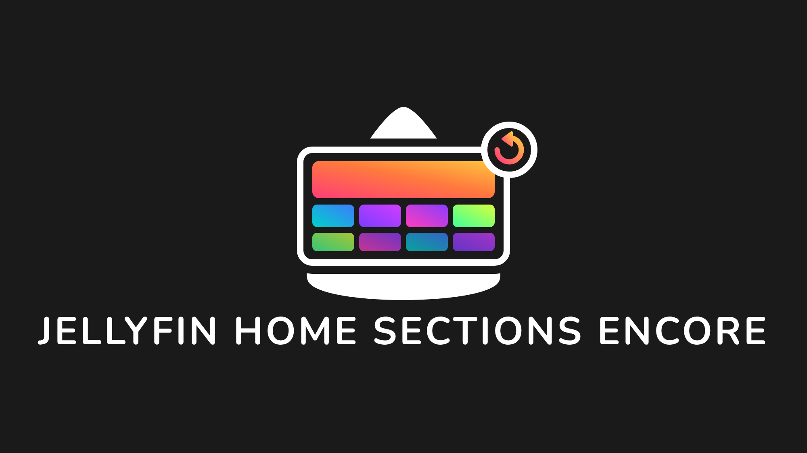

<h1 align="center">Home Screen Sections Encore</h1>
<h2 align="center">A Jellyfin Plugin</h2>
<p align="center">
	
	<br />
	<br />
	<a href="https://github.com/ApenasAngelo/jellyfin-plugin-home-sections-encore">
		
	</a>
</p>

**Home Screen Sections Encore** is a fork of [Home Screen Sections](https://github.com/IAmParadox27/jellyfin-plugin-home-sections) by IAmParadox27. *Encore* means "once more": the same Netflix-style rows, taken further.

The fork follows upstream closely: `main` mirrors upstream `main`, and our work lives on the `encore` branch, merged from `main` whenever upstream releases. New sections and features go into new files whenever possible, so syncing stays cheap.

## What's different in Encore

| Change | Status |
|---|---|
| Runs on Jellyfin 12.4: the web client hooks are found automatically in the served bundle instead of being hard-coded per version | planned |
| Own plugin GUID, name and assembly (the assembly name still contains `.HomeScreenSections`, so plugins that register sections keep working) | planned |
| Sections load as they scroll into view, with server-side caching | planned |
| More Netflix-style sections (remaining episodes, themed rows from TMDB keywords, anime picks, featured collections, daily picks...) | planned |
| Library pages (Movies, Shows, mixed libraries), the Collections tab and single collection pages laid out like the home screen | planned |

## Introduction
Home Screen Sections (HSS) is a Jellyfin plugin which allows users to update their web client's home screen to be a bit more dynamic and more "Netflixy".

### Sections Included
A lot of the sections included are the base sections that would appear in a vanilla instance of Jellyfin. This has been done because using HSS hasn't been integrated to work side by side with the vanilla home screen and instead wholesale replaces it. Since a lot of the sections are useful and contain everything you'd want in a home screen they've been included for convenience.

> **NOTE**: Its worth noting that the sections that have been created are one's that I myself use for my own instance, if there is a section that's missing/you'd like to request, you can open a feature request on my features dashboard: https://features.iamparadox.dev/ or implement it yourself and open a PR to have it merged or create a plugin that is integrated with this one (see below)!

These vanilla sections are listed here:

- My Media
	- Same as vanilla Jellyfin
- Continue Watching
	- Same as vanilla Jellyfin
- Next Up
	- Same as vanilla Jellyfin
- Recently Added Media
	- Mostly the same as vanilla Jellyfin, current exception is that all libraries appear in 1 section rather than unique ones per library. This vanilla behaviour is being worked on and will soon be supported.
- Live TV
	- Mostly the same as vanilla Jellyfin. _Current State is untested since updating to 10.10.3 so may find that there are issues_

The sections that are new for this plugin (and most likely the reason you would use this plugin in the first place) are outlined here:

- Latest Movies/TV Shows
    - These are movies/shows that have recently aired (or released) rather than when they were added to your library. 

- Because You Watched
	- Very similar to Netflix's "because you watched" section

- Watch Again
	- Again similar to Netflix's feature of the same name, this will show Movies in a Collection and TV Shows that have been watched to their completion and will provide the user an option to watch the show/movie collection again. The listed entry will be the first movie to be released in that collection (done by Premiere Date) or the first episode in the series.

- Genre
	- Selects a weighted random set of genres based on the users viewing history and displays movies within that genre.

- Studio/Network
	- More content from a studio or network the user watches a lot of (e.g. "More from Studio - Warner Bros. Pictures" or "More from Network - HBO"), based on their primary studio/network. Each user sees a different studio, chosen by their own watch history.

- Decade
	- A "Best of the 1990s" style row, weighted towards the decades the user actually watches. Each user sees a different decade.

- Starring
	- Other movies/shows featuring an actor who appears in the user's library (e.g. "Starring Pedro Pascal"). Each user sees a different actor, picked randomly each load.

- Directed By
	- Other movies/shows from a director who appears in the user's library (e.g. "Directed by Denis Villeneuve"). Each user sees a different director, picked randomly each load.

- Hidden Gems
	- Highly rated movies and shows (7.5+) that the user hasn't watched yet. A random subset is picked each time it loads.

- Finish These Collections
	- Box sets/collections the user has started but not finished, ordered by how close they are to completion (closest first).

- Discover
	- The discover sections are integrated with Jellyseerr to bring the Discover Movies, Discover Shows and Trending sections of Jellyseerr into Jellyfin. They will only show media that isn't available in your library and have a direct request button right on the card for convenient requesting.

- My Requests
	- Another Jellyseerr integrated section that allows the user to see all their requested media in a single row.

- Upcoming
 	- The upcoming sections are integrated into the *arrs to bring their calendars as sections in Jellyfin.

<details>
	<summary><strong>Expand for screenshot of what the home screen can turn into.</strong></summary>
	<i>Please note: Images have been blurred</i>
	
</details>

## Installation

### Prerequisites
- Jellyfin 12.4 (other versions are not tested by this fork).
- [File Transformation](https://github.com/IAmParadox27/jellyfin-plugin-file-transformation) (required).

### Installation
1. In Jellyfin, go to **Dashboard → Plugins → Repositories** and add
   `https://raw.githubusercontent.com/ApenasAngelo/jellyfin-plugins/main/manifest.json` (releases are not published yet).
2. If the original Home Screen Sections is installed, uninstall it first.
3. Install **Home Screen Sections Encore** from the **Catalog** and restart Jellyfin.
4. Configure the sections in **Dashboard → Plugins → Home Screen Sections Encore**.
5. Refresh the browser (or wait for the app cache to clear).

### FAQ
<details>
	<summary><strong>I've installed the plugins and don't get any options or changes. How do I fix?</strong></summary>

This is common, particularly on a fresh install. The first thing you should try is the following
1. Launch your browsers developer tools


3. Open the **Network** tab across the top bar
4. Check the **Disable cache** checkbox
5. Refresh the page **while the dev tools are still open**


</details>

<details>
	<summary><strong>How can I tell if its worked?</strong></summary>

> The easiest way to confirm whether the user is using the modular home settings is to check whether the movie posters are portrait or landscape. Due to how the cards are delivered from the backend all cards are forced to be landscape
</details>


## Contribution

This fork is tailored to a personal server. Bugs that also exist upstream belong in the [Home Screen Sections issues](https://github.com/IAmParadox27/jellyfin-plugin-home-sections/issues); issues specific to Encore are welcome here. Translations live in `src/Jellyfin.Plugin.HomeScreenSections/_Localization`, as upstream.

### Code style

Encore follows the upstream code style, so merges from upstream stay clean:

- no whitespace-only changes (turn off auto-formatters on upstream files);
- avoid `var` unless namespaces differ between Jellyfin versions;
- braces on new lines, even for one-line statements;
- the author's "mutated hungarian" naming (`m_` fields and so on);
- in upstream files, only short hooks marked `// Encore:`; everything else in new files.

### Adding your own sections
> This is great an' all but I want a section that doesn't exist here. Can I make one?

Yep! Home Screen Sections exposes a static interface which can be used to register sections.

Due to issues with Jellyfin's plugins being loaded into different load contexts this cannot be referenced directly. Instead you can use reflection to invoke the plugin directly to register your section.

1. Prepare your payload
```json
{
    "id": "00000000-0000-0000-0000-000000000000", // Guid
    "displayText": "", // What text should be displayed by default for your section
    "limit": 1, // The number of times this section can appear up to
    "route": "", // The route that should be linked on the section header, if applicable
    "additionalData": "", // Any accompanying data you want sent to your results handler
	"resultsAssembly": GetType().Assembly.FullName, // Example value is a string from C# that should be resolved before adding to json
	"resultsClass": "", // The name of the class that should be invoked from the above assembly
	"resultsMethod": "" // The name of the function that should be invoked from the above class
}
```
2. Send your payload to the home screen sections assembly
```csharp
Assembly? homeScreenSectionsAssembly =
	AssemblyLoadContext.All.SelectMany(x => x.Assemblies).FirstOrDefault(x =>
		x.FullName?.Contains(".HomeScreenSections") ?? false);

if (homeScreenSectionsAssembly != null)
{
	Type? pluginInterfaceType = homeScreenSectionsAssembly.GetType("Jellyfin.Plugin.HomeScreenSections.PluginInterface");

	if (pluginInterfaceType != null)
	{
		pluginInterfaceType.GetMethod("RegisterSection")?.Invoke(null, new object?[] { payload });
	}
}
```

When your section results method is invoked you will receive an object representing the following json format (it will try to serialize it to the type you specify in the signature)
```json
{
  "UserId": "", // The GUID of the user that is requesting the section
  "AdditionalData": "" // The additional data you sent in the registration
}
```

The `/HomeScreen/Sections`, `/HomeScreen/Section/{sectionType}` and `/ModularHomeViews/UserSettings` endpoints require authentication as an existing user. Clients can continue sending `userId`, but it must match the authenticated user, including for administrators; a different ID returns HTTP 403. Omitting `userId` from `/HomeScreen/Sections` or `GET /ModularHomeViews/UserSettings` uses the authenticated user. Section results handlers receive that user in `UserId`.

You must make sure that your section results method returns a `QueryResult<BaseItemDto>`.

## Credits

Home Screen Sections Encore stands on the work of [IAmParadox27](https://github.com/IAmParadox27) and the contributors of [Home Screen Sections](https://github.com/IAmParadox27/jellyfin-plugin-home-sections), plus the [File Transformation](https://github.com/IAmParadox27/jellyfin-plugin-file-transformation) plugin it relies on. Licensed under the GNU GPL v3, like the original.
